# TP2 REST : Service web « Calculatrice » avec JAX-RS et Tomcat

| | |
|---|---|
| **Matière** | Architecture MicroServices |
| **Filière** | MPSRCC1 |
| **Établissement** | Faculté des Sciences de Sfax, Département d'informatique et des Communications |
| **Année universitaire** | 2026-2027 |
| **Enseignantes** | Corinne Amel ZAYANI, Amal ABID |
| **Étudiante** | Fatma Cherif |

## Sommaire
1. [Objectif](#1-objectif)
2. [Environnement](#2-environnement)
3. [Structure du projet](#3-structure-du-projet)
4. [Vérification du déploiement (hello-world)](#4-vérification-du-déploiement-hello-world)
5. [Partie A : conception](#5-partie-a--conception)
6. [Parties C, D, E : calculs directs et JSON](#6-parties-c-d-e--calculs-directs-et-json)
7. [Partie F : ressource operations](#7-partie-f--ressource-operations)
8. [Questions de synthèse](#8-questions-de-synthèse)
9. [Remarques](#9-remarques)

---

## 1. Objectif
Développer un service web REST « Calculatrice » avec JAX-RS (Jersey), le déployer dans Tomcat 10.1, puis le tester avec un navigateur, curl et Postman.

Le service comporte deux familles d'URI :
- **calculs directs** (`/calcul/...`) : somme, soustraction, produit, division, sans stockage ;
- **historique des opérations** (`/operations`) : création, lecture, modification et suppression, avec stockage en mémoire.

## 2. Environnement
| Outil | Version / détail |
|---|---|
| JDK | 17 ou plus (`release 17` dans le `pom.xml`) |
| Maven | 3.9+ (intégré à IntelliJ), packaging `war` |
| Serveur | Apache Tomcat 10.1.61 |
| API / implémentation | JAX-RS 3.1 (Jakarta EE 10) / Jersey 3.1.9 |
| IDE | IntelliJ IDEA |
| Outils de test | navigateur, curl, Postman |

- **Contexte de déploiement :** `/RestWebApp_war_exploded` (contexte par défaut d'IntelliJ pour l'artefact `war exploded`)
- **URL de base :** `http://localhost:8080/RestWebApp_war_exploded/api`

## 3. Structure du projet
```
TP2-MS/
├── pom.xml
├── README.md
├── captures/                      (captures d'écran des tests)
└── src/main/java/com/exemple/restwebapp/
    ├── HelloApplication.java      (généré par le modèle IntelliJ)
    ├── HelloResource.java         (généré par le modèle IntelliJ)
    ├── RestApplication.java       (@ApplicationPath("/api"))
    ├── Calculatrice.java          (logique métier)
    ├── CalculRest.java            (ressource /calcul)
    ├── Resultat.java              (objet renvoyé en JSON)
    ├── Operation.java             (objet de l'historique)
    └── OperationRest.java         (ressource /operations)
```
Le paquetage du projet est `com.exemple.restwebapp` (généré par IntelliJ), et non `com.exemple.rest` comme dans le sujet. Cela ne change pas le fonctionnement.

### Rôle des classes
| Classe | Rôle |
|---|---|
| `Calculatrice` | quatre calculs, sans aucune notion de HTTP ; `division` lève une `ArithmeticException` si b = 0 |
| `RestApplication` | active JAX-RS avec `@ApplicationPath("/api")` |
| `CalculRest` | expose la calculatrice sous `/calcul` (somme, soustraction, produit, division, variantes JSON) |
| `Resultat` | objet Java converti automatiquement en JSON (constructeur sans argument + accesseurs) |
| `Operation` | une opération de l'historique : `id`, `operateur`, `a`, `b`, `resultat` |
| `OperationRest` | ressource `/operations` : POST, GET (liste et par id), PUT, DELETE ; stockage dans une `ConcurrentHashMap` statique et un `AtomicInteger` pour les identifiants |

### Construction et exécution
1. Ouvrir le projet dans IntelliJ et recharger Maven (**Reload All Maven Projects**).
2. Construire : `mvn clean package` (produit `target/RestWebApp.war`) ou **Build > Build Project**.
3. Configurer Tomcat 10.1 (**Run > Edit Configurations**), artefact `RestWebApp:war exploded`.
4. Lancer Tomcat avec **Run**.

Les opérations de la partie F sont en mémoire : elles sont perdues à chaque redéploiement et la numérotation repart de 1.

## 4. Vérification du déploiement (hello-world)
Test demandé en début de séance pour confirmer que le projet est déployé au bon endroit :

`http://localhost:8080/RestWebApp_war_exploded/api/hello-world`


---

## 5. Partie A : conception

### A.1 Le service à réaliser
**Famille 1 : calculs directs** (rien n'est enregistré)

| Verbe | URI | Rôle |
|---|---|---|
| GET | /calcul/somme?a=2&b=3 | Retourne a + b |
| GET | /calcul/soustraction?a=2&b=3 | Retourne a − b |
| GET | /calcul/produit?a=2&b=3 | Retourne a × b |
| GET | /calcul/division?a=6&b=3 | Retourne a ÷ b |

**Famille 2 : historique des opérations** (chaque calcul enregistré devient une ressource)

| Verbe | URI | Rôle |
|---|---|---|
| POST | /operations | Crée une opération (calculée et enregistrée) |
| GET | /operations | Retourne toutes les opérations |
| GET | /operations/{id} | Retourne l'opération numéro id |
| PUT | /operations/{id} | Modifie l'opération numéro id |
| DELETE | /operations/{id} | Supprime l'opération numéro id |

### A.2 Questions de conception
1. **Pourquoi les calculs directs utilisent-ils GET et non POST ?**
   Un calcul direct ne fait que lire un résultat : il ne crée et ne modifie rien sur le serveur. GET sert à la lecture, POST à la création.
2. **Comment s'appelle la partie située après le `?` dans `/calcul/somme?a=2&b=3` ?**
   Ce sont les **paramètres de requête** (*query string*).
3. **Différence entre `/operations` et `/operations/3` ?**
   `/operations` désigne la **collection** de toutes les opérations. `/operations/3` désigne **une seule ressource**, celle d'identifiant 3.
4. **Statut HTTP pour `/operations/99` inexistante ?**
   **404 Not Found**.

---

## 6. Parties C, D, E : calculs directs et JSON

Récapitulatif des tests (URL à préfixer par `http://localhost:8080/RestWebApp_war_exploded/api`) :

| Test | Requête | Statut | Corps |
|---|---|---|---|
| C.7 | GET /calcul/somme?a=2&b=3 | 200 | `5` (`Content-Type: text/plain`) |
| C.1 | POST /calcul/somme?a=2&b=3 | 405 | page d'erreur Tomcat, en-tête `Allow: GET,OPTIONS` |
| D.1 | GET /calcul/soustraction?a=10&b=4 | 200 | `6` |
| D.1 | GET /calcul/produit?a=6&b=7 | 200 | `42` |
| D.2 | GET /calcul/division?a=7&b=2 | 200 | `3.5` |
| D.2 | GET /calcul/division?a=7&b=0 | 400 | `Erreur : division par 0 impossible` |
| D.3 | GET /calcul/somme?a=2 | 200 | `2` |
| D.3 | GET /calcul/somme?a=abc&b=3 | 404 | page d'erreur Tomcat |
| D.4 | GET /calcul/produit/6/7 | 200 | `42` |
| E.2 | GET /calcul/somme/detail?a=2&b=3 | 200 | `{"a":2,"b":3,"operation":"somme","resultat":5.0}` |
| E.3 | idem, en-tête `Accept: application/xml` | 406 | page d'erreur Tomcat |

### Partie C : première ressource (somme)
La méthode `somme` de `CalculRest` répond à `GET /calcul/somme?a=2&b=3` et renvoie le résultat en texte brut.

**Test navigateur (C.7)** : la page affiche `5`.
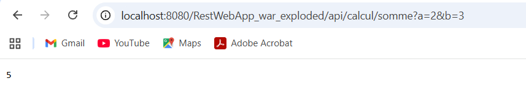

**Question C.1.** En envoyant un **POST** sur `/calcul/somme?a=2&b=3`, j'obtiens le statut **405 Method Not Allowed**, avec l'en-tête `Allow: GET,OPTIONS`. L'URI existe, mais la méthode n'est annotée que par `@GET` : le serveur refuse le verbe POST et indique les verbes autorisés.

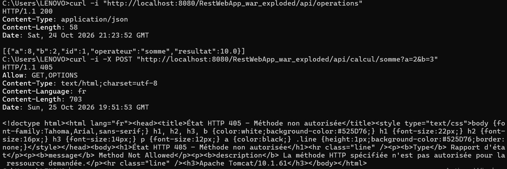

### Partie D : compléter la calculatrice

**D.1** : les méthodes `soustraction` et `produit` ont été ajoutées sur le modèle de `somme`.

**D.2 : division et gestion d'erreur.** Si b vaut 0, l'erreur vient du client : le service répond **400 Bad Request** et non un résultat faux ou une erreur interne.

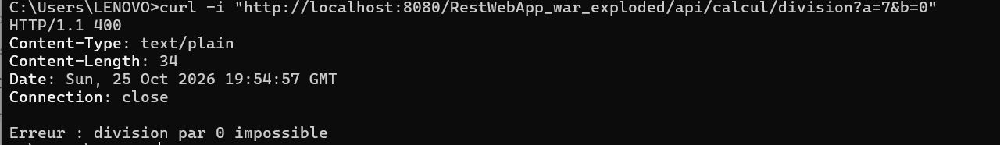

**D.3 : observations**
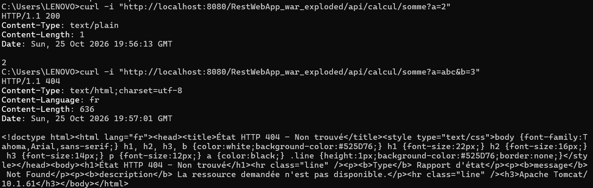

**Question D.1.** Quelle valeur JAX-RS donne-t-il à un paramètre entier absent ?
JAX-RS donne la **valeur par défaut du type** : **0** pour un `int`. Ainsi `somme?a=2` calcule 2 + 0 et renvoie `2`.

**Question D.2.** Quel statut obtient-on lorsque le paramètre n'est pas un entier ? La méthode a-t-elle été exécutée ?
Avec `a=abc`, le statut est **404**. La conversion de `abc` en entier échoue **avant** l'appel : la méthode `somme` **n'est pas exécutée**.

**D.4 : `@PathParam`.** La méthode `produitChemin` lit les valeurs dans le chemin : `GET /calcul/produit/6/7` renvoie `42`.


**Question D.3.** Différence entre `@QueryParam` et `@PathParam` ?
`@QueryParam` lit un paramètre placé après le `?` (`?a=2&b=3`). `@PathParam` lit une valeur placée **dans le chemin** de l'URI (`/produit/6/7`). Pour lire l'identifiant dans `/operations/{id}`, on utilise **`@PathParam`**.

### Partie E : échanger des données en JSON
La classe `Resultat` (constructeur public sans argument et accesseurs) est convertie automatiquement en JSON. La méthode `sommeDetail` annonce `@Produces(MediaType.APPLICATION_JSON)`.

**E.2 : réponse JSON**
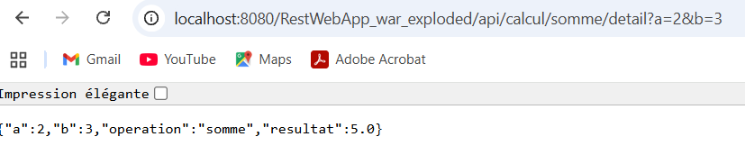

**E.3 : en-tête `Accept`**
Avec `Accept: application/json`, la réponse est `200`. Avec `Accept: application/xml`, la réponse est `406`.
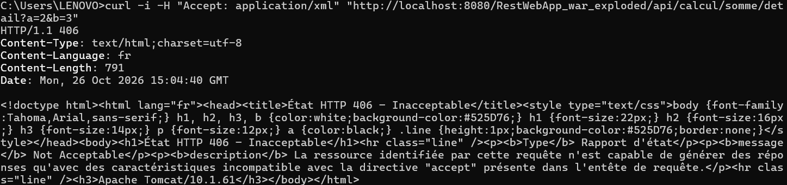

**E.4 : exercice.** La méthode `divisionDetail` répond à `GET /calcul/division/detail?a=..&b=..`, renvoie un objet `Resultat` en JSON, et le statut `400` si b vaut 0.

**Question E.1.** Qui a effectué la conversion en JSON ? D'où viennent les noms `a`, `b`, `operation`, `resultat` ?
La conversion est effectuée par **Jersey**, grâce à la dépendance `jersey-media-json-binding` (JSON-B). Les noms viennent des **accesseurs** (`getA()`, `getB()`, `getOperation()`, `getResultat()`) de la classe `Resultat`.

**Question E.2.** Pourquoi la seconde requête (`Accept: application/xml`) est-elle refusée ?
La méthode ne produit que `application/json` (`@Produces`). Le client réclame du XML : le serveur ne peut pas satisfaire la demande et répond **406 Not Acceptable**.

---

## 7. Partie F : ressource operations
Tests réalisés avec **Postman**. Pour chaque test : requête envoyée, statut et corps obtenus. URL de base : `http://localhost:8080/RestWebApp_war_exploded/api`.

Le premier test (POST) a été exécuté après un redéploiement : les identifiants commencent donc à 1.

### F.3 : création et lecture
| N° | Requête | Corps envoyé | Statut | Réponse | Capture |
|---|---|---|---|---|---|
| 1 | POST /operations | `{"operateur":"somme","a":8,"b":2}` | 201 | `{"a":8,"b":2,"id":1,"operateur":"somme","resultat":10.0}` + en-tête `Location` | oui |
| 2 | POST /operations | `{"operateur":"division","a":7,"b":2}` | 201 | opération `id` 2, `resultat` 3.5 | oui |
| 3 | GET /operations | aucun | 200 | tableau JSON des deux opérations | oui |
| 4 | GET /operations/2 | aucun | 200 | l'opération d'identifiant 2 | non |
| 5 | GET /operations/99 | aucun | 404 | page d'erreur Tomcat | oui |
| 6 | POST /operations | `{"operateur":"division","a":7,"b":0}` | 400 | `{"erreur":"Calcul impossible"}` | oui |
| 7 | POST /operations | `{"operateur":"racine","a":9,"b":0}` | 400 | `{"erreur":"Calcul impossible"}` | non |

**Test 1 : POST création (somme)**
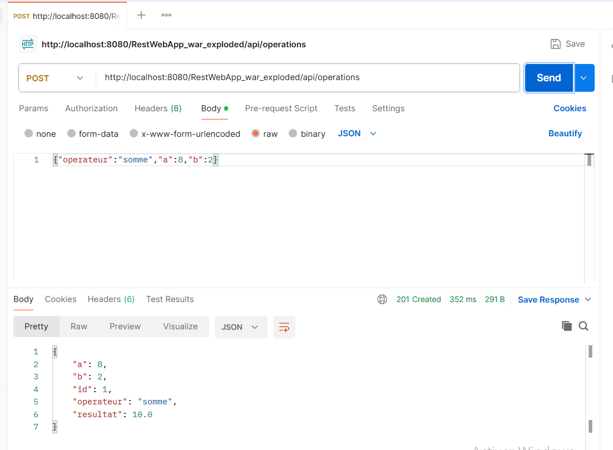

**Test 2 : POST création (division)**
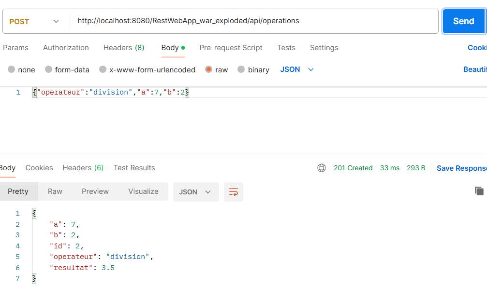

**Test 3 : GET de la collection**
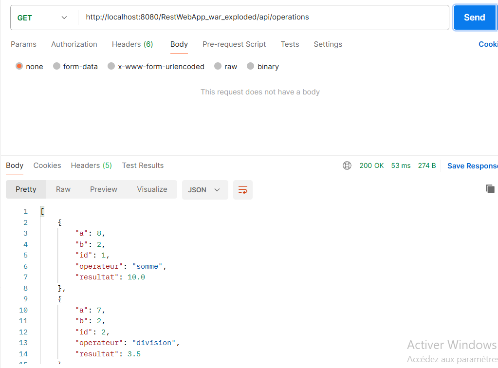

**Test 5 : GET d'un identifiant inexistant**
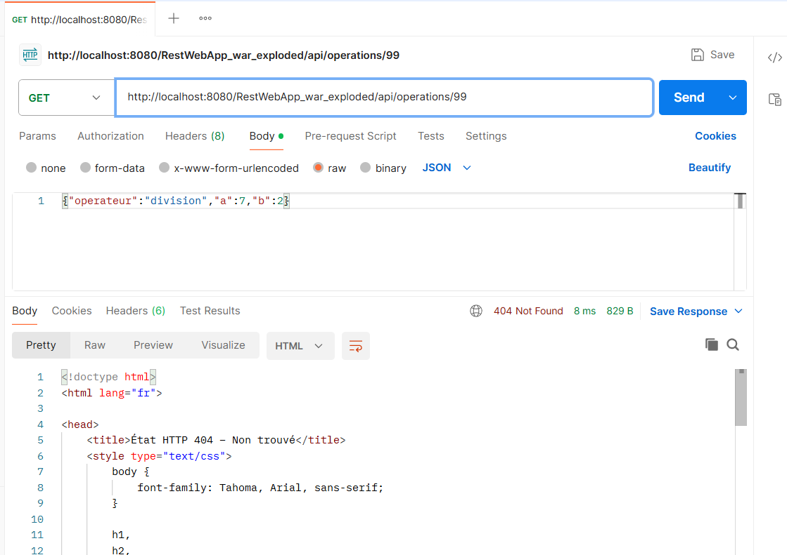

**Test 6 : division par 0 refusée**
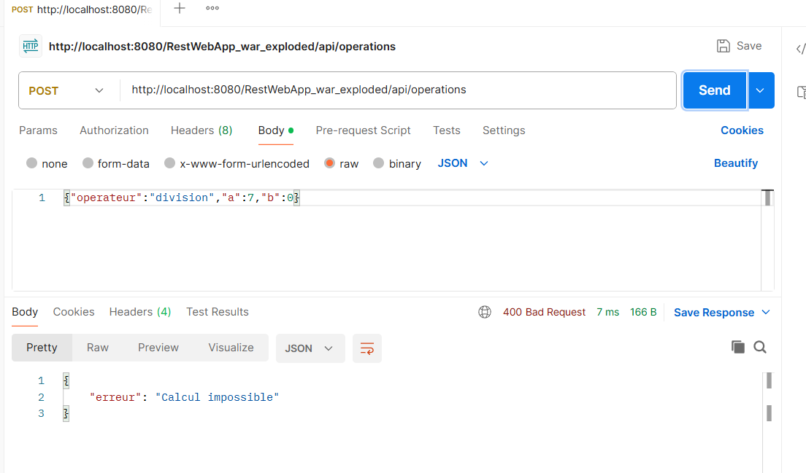

*Tests 4 et 7 : capture non incluse ; le comportement est identique à celui des tests 3 et 6.*

### F.4 : modification (PUT)
La méthode `modifier` (`@PUT`, `@Path("/{id}")`, `@Consumes(APPLICATION_JSON)`) vérifie que l'identifiant existe, recalcule avec `calculer`, puis fixe l'identifiant (`op.setId(id)`) et remplace l'opération (`OPERATIONS.put(id, op)`).

| N° | Requête | Corps envoyé | Statut | Réponse | Capture |
|---|---|---|---|---|---|
| 8 | PUT /operations/1 | `{"operateur":"produit","a":8,"b":2}` | 200 | `id` 1, `resultat` 16.0 | oui |
| 9 | GET /operations/1 | aucun | 200 | `resultat` 16.0 | non |
| 10 | PUT /operations/99 | `{"operateur":"produit","a":8,"b":2}` | 404 | page d'erreur Tomcat | non |
| 11 | PUT /operations/1 | `{"operateur":"division","a":8,"b":0}` | 400 | `{"erreur":"Calcul impossible"}` | non |

**Test 8 : PUT réussi**
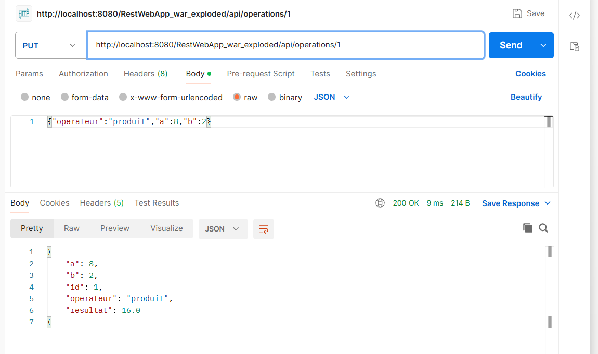

*Tests 9, 10 et 11 : capture non incluse. Le statut 404 pour un identifiant inexistant est illustré par les tests 5 (F.3) et 13 (F.5) ; le statut 400 pour un calcul impossible par le test 6.*

### F.5 : suppression (DELETE)
La méthode `supprimer` (`@DELETE`, `@Path("/{id}")`) utilise `OPERATIONS.remove(id)` : elle renvoie 404 si l'opération n'existait pas, sinon `Response.noContent()` (204).

| N° | Requête | Statut | Réponse | Capture |
|---|---|---|---|---|
| 12 | DELETE /operations/1 | 204 No Content | vide | oui |
| 13 | GET /operations/1 | 404 | page d'erreur Tomcat | oui |
| 14 | DELETE /operations/1 | 404 | page d'erreur Tomcat | non |

**Test 12 : suppression réussie** (corps de la requête vide, corps de la réponse vide)
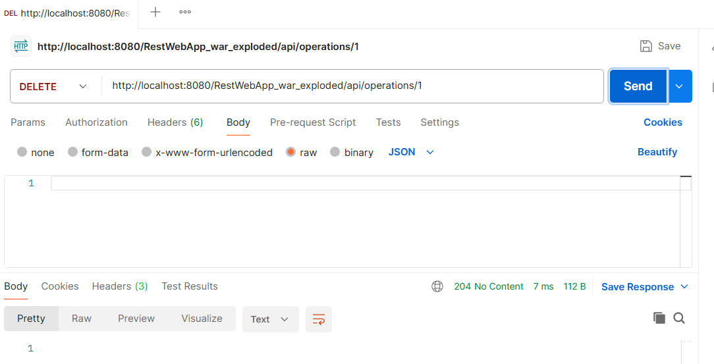

**Test 13 : lecture après suppression**
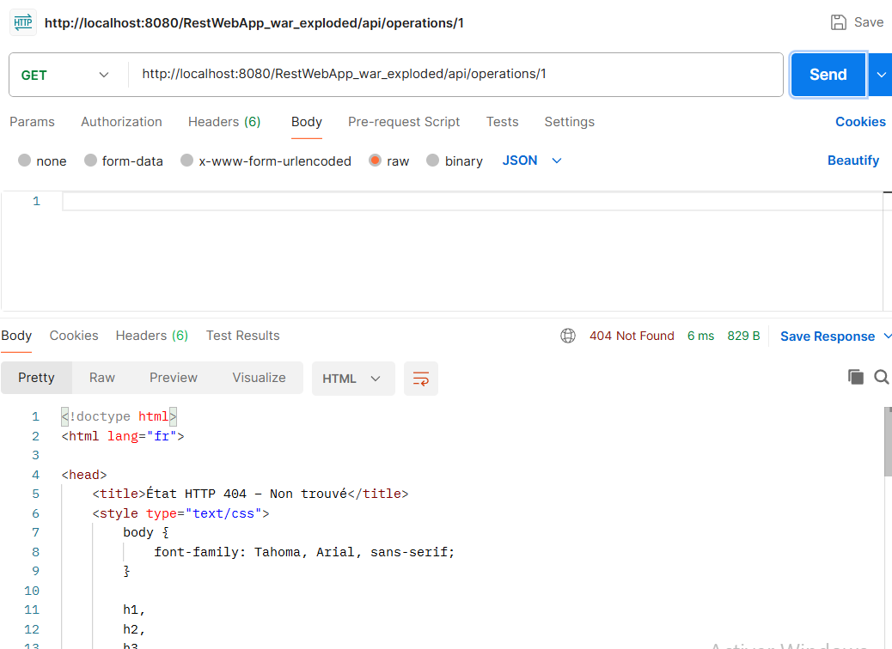

*Test 14 : capture non incluse ; le comportement est identique au test 13.*

---

## 8. Questions de synthèse

### 1. Tableau de l'étape A.1 avec les codes de statut
| Verbe | URI | Statuts possibles |
|---|---|---|
| GET | /calcul/somme | 200 ; 404 (paramètre non entier) |
| GET | /calcul/soustraction | 200 ; 404 (paramètre non entier) |
| GET | /calcul/produit | 200 ; 404 (paramètre non entier) |
| GET | /calcul/division | 200 ; 400 (b = 0) ; 404 (paramètre non entier) |
| POST | /operations | 201 ; 400 (calcul impossible) ; 415 (corps non JSON) |
| GET | /operations | 200 |
| GET | /operations/{id} | 200 ; 404 |
| PUT | /operations/{id} | 200 ; 400 ; 404 |
| DELETE | /operations/{id} | 204 ; 404 |

### 2. Annotations JAX-RS utilisées
| Annotation | Rôle |
|---|---|
| `@ApplicationPath` | active JAX-RS et fixe le préfixe de toutes les URI (`/api`) |
| `@Path` | associe une classe ou une méthode à une URI |
| `@GET`, `@POST`, `@PUT`, `@DELETE` | associent une méthode au verbe HTTP correspondant |
| `@Produces` | indique le type de contenu renvoyé (texte, JSON) |
| `@Consumes` | indique le type de contenu attendu dans le corps de la requête |
| `@QueryParam` | lit un paramètre de requête (`?a=2`) |
| `@PathParam` | lit une valeur placée dans le chemin (`{id}`) |
| `@Context` | injecte un objet du contexte (ici `UriInfo`, pour construire l'en-tête `Location`) |

### 3. Différence entre JAX-RS et Jersey
**JAX-RS** est la **spécification** : l'API standard Jakarta (annotations et règles). **Jersey** en est une **implémentation** : le code qui fait réellement fonctionner ces annotations.

### 4. Rôle de Tomcat et fichier `.war`
Tomcat est un **conteneur de servlets** : il reçoit les requêtes HTTP et les transmet à l'application. Le projet produit un `.war` parce que l'application est déployée **dans** un serveur existant, qui fournit la partie HTTP. Un `.jar` exécutable embarquerait son propre serveur, ce qui n'est pas le cas ici.

### 5. Principe stateless et liste d'opérations
Le principe stateless interdit au serveur de mémoriser le **contexte d'un client** (session) entre deux requêtes : chaque requête contient tout ce qu'il faut pour être traitée. La liste d'opérations est l'**état des ressources** du service, partagé par tous les clients, et non un état de conversation avec un client précis. Il n'y a donc pas de contradiction.

### 6. POST répété et PUT répété
Envoyer deux fois `POST /operations` crée **deux opérations distinctes** (id 1 puis id 2) : POST n'est **pas idempotent**. Envoyer deux fois `PUT /operations/1` donne le **même résultat final** qu'un seul envoi : PUT est **idempotent**.

---

## 9. Remarques
- Les opérations sont stockées dans une `ConcurrentHashMap` statique : elles sont perdues à chaque redéploiement de Tomcat.
- Le sujet utilise le contexte `/RestWebApp` ; dans ce projet, le contexte est `/RestWebApp_war_exploded` (valeur par défaut d'IntelliJ).
- Pour un identifiant inexistant ou une méthode non autorisée, Tomcat renvoie sa page d'erreur HTML par défaut : d'où l'absence de corps JSON dans les tests 5, 13 et C.1.
- Les classes `HelloApplication` et `HelloResource`, générées par le modèle IntelliJ, ont été conservées : elles ont servi au test `hello-world` demandé en début de séance.
