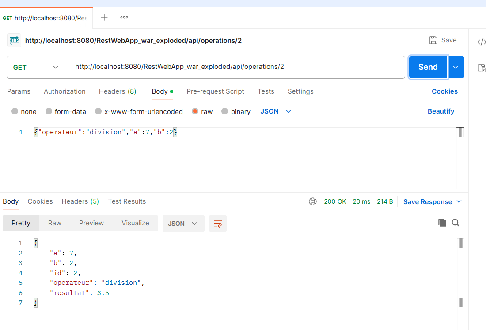
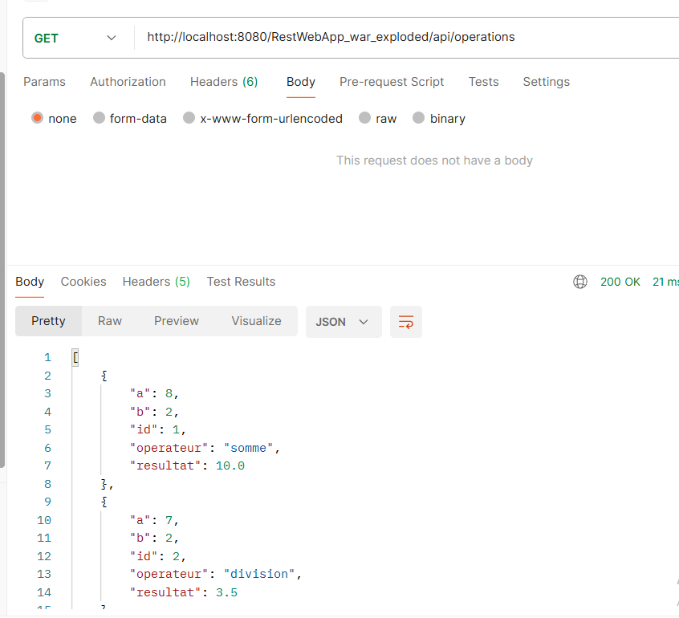

# TP2 REST : Service web « Calculatrice » avec JAX-RS et Tomcat

**Matière :** Architecture MicroServices, **Filière :** MPSRCC1
**Étudiante :** Fatma Chérif

## 1. Environnement
- JDK 17+, Maven, Apache Tomcat 10.1.61, IntelliJ IDEA
- JAX-RS (Jakarta EE 10), implémentation Jersey 3.1.9
- Contexte de déploiement : `/RestWebApp_war_exploded`
- URL de base : `http://localhost:8080/RestWebApp_war_exploded/api`

## 2. Structure du projet
```
RestWebApp/
├── pom.xml
└── src/main/java/com/exemple/rest/
    ├── Calculatrice.java
    ├── RestApplication.java
    ├── CalculRest.java
    ├── Resultat.java
    ├── Operation.java
    └── OperationRest.java
```

## 3. Réponses aux questions

### Partie A : conception
1. **Pourquoi GET et non POST ?** Un calcul direct ne fait que lire un résultat : il ne crée ni ne modifie rien sur le serveur. GET sert à la lecture, POST à la création.
2. **Nom de la partie après le `?`** : les paramètres de requête (*query string*).
3. **`/operations` et `/operations/3`** : `/operations` désigne la collection de toutes les opérations ; `/operations/3` désigne une seule ressource, celle d'identifiant 3.
4. **Statut pour `/operations/99` inexistante** : `404 Not Found`.

### Partie C
**Question C.1** : en envoyant POST sur `/calcul/somme`, j'obtiens le statut **405 Method Not Allowed** ⚠️. L'URI existe, mais la méthode n'est annotée que par `@GET` : le serveur refuse le verbe POST.

### Partie D
- **D.1** : pour un paramètre entier absent, JAX-RS donne la valeur par défaut du type, **0** ⚠️ (`somme?a=2` renvoie `2`).
- **D.2** : avec `a=abc`, j'obtiens le statut **404** ⚠️. La conversion en entier échoue avant l'appel : la méthode `somme` **n'est pas exécutée**.
- **D.3** : `@QueryParam` lit un paramètre placé après le `?` (`?a=2&b=3`). `@PathParam` lit une valeur placée dans le chemin (`/produit/6/7`). Pour `/operations/{id}`, on utilise `@PathParam`.

### Partie E
- **E.1** : la conversion est faite par **Jersey** (module `jersey-media-json-binding`, JSON-B). Les noms `a`, `b`, `operation`, `resultat` viennent des **accesseurs** (`getA()`, `getOperation()`…) de la classe `Resultat`.
- **E.2** : la méthode ne produit que `application/json` (`@Produces`). Le client demande `application/xml` : le serveur ne peut pas satisfaire la demande, d'où **406 Not Acceptable**.

### Questions de synthèse

**1. Tableau A.1 avec les codes de statut**

| Verbe | URI | Statuts possibles |
|---|---|---|
| GET | /calcul/somme | 200 ; 404 (paramètre non entier) |
| GET | /calcul/soustraction | 200 ; 404 (paramètre non entier) |
| GET | /calcul/produit | 200 ; 404 (paramètre non entier) |
| GET | /calcul/division | 200 ; 400 (b = 0) ; 404 (paramètre non entier) |
| POST | /operations | 201 ; 400 (calcul impossible) ; 415 (corps non JSON) |
| GET | /operations | 200 |
| GET | /operations/{id} | 200 ; 404 |
| PUT | /operations/{id} | 200 ; 400 ; 404 |
| DELETE | /operations/{id} | 204 ; 404 |

**2. Annotations JAX-RS utilisées**

| Annotation | Rôle |
|---|---|
| `@ApplicationPath` | active JAX-RS et fixe le préfixe de toutes les URI (`/api`) |
| `@Path` | associe une classe ou une méthode à une URI |
| `@GET`, `@POST`, `@PUT`, `@DELETE` | associent une méthode au verbe HTTP correspondant |
| `@Produces` | indique le type de contenu renvoyé (texte, JSON) |
| `@Consumes` | indique le type de contenu attendu dans le corps de la requête |
| `@QueryParam` | lit un paramètre de requête (`?a=2`) |
| `@PathParam` | lit une valeur placée dans le chemin (`{id}`) |
| `@Context` | injecte un objet du contexte (ici `UriInfo`) |

**3. JAX-RS et Jersey** : JAX-RS est la **spécification** (annotations et règles standard Jakarta). Jersey en est une **implémentation** : le code qui fait fonctionner ces annotations.

**4. Rôle de Tomcat et fichier .war** : Tomcat est un conteneur de servlets : il reçoit les requêtes HTTP et les transmet à l'application. Le projet produit un `.war` car l'application est déployée *dans* un serveur existant qui fournit la partie HTTP. Un `.jar` exécutable embarquerait son propre serveur, ce qui n'est pas le cas ici.

**5. Stateless et liste d'opérations** : le principe stateless interdit de mémoriser le contexte d'un **client** (session) entre deux requêtes ; chaque requête contient tout ce qu'il faut pour être traitée. La liste d'opérations est l'**état des ressources** du service, partagé par tous les clients, et non un état de conversation avec un client précis. Ce n'est donc pas une contradiction.

**6. POST ×2 et PUT ×2** : deux fois `POST /operations` crée **deux** opérations distinctes (id 1 puis 2) : POST n'est **pas idempotent**. Deux fois `PUT /operations/1` donne le **même résultat final** qu'un seul appel : PUT est **idempotent**.

## 4. Tests de la partie F (Postman)

Les opérations sont conservées en mémoire : elles sont perdues à chaque redéploiement.

### F.3 : création et lecture

| N° | Requête | Corps envoyé | Statut | Réponse |
|---|---|---|---|---|
| 1 | POST /operations | `{"operateur":"somme","a":8,"b":2}` | 201 | `{"a":8,"b":2,"id":1,"operateur":"somme","resultat":10.0}` + en-tête `Location` |
| 2 | POST /operations | `{"operateur":"division","a":7,"b":2}` | 201 | opération id 2, résultat 3.5 |
| 3 | GET /operations | — | 200 | tableau des 2 opérations |
| 4 | GET /operations/2 | — | 200 | opération 2 |
| 5 | GET /operations/99 | — | 404 | page d'erreur Tomcat |
| 6 | POST /operations | `{"operateur":"division","a":7,"b":0}` | 400 | `{"erreur":"Calcul impossible"}` |
| 7 | POST /operations | `{"operateur":"racine","a":9,"b":0}` | 400 | `{"erreur":"Calcul impossible"}` |






### F.4 : PUT

| N° | Requête | Corps envoyé | Statut | Réponse |
|---|---|---|---|---|
| 8 | PUT /operations/1 | `{"operateur":"produit","a":8,"b":2}` | 200 | id 1, résultat 16.0 |
| 9 | GET /operations/1 | — | 200 | résultat 16.0 |
| 10 | PUT /operations/99 | `{"operateur":"produit","a":8,"b":2}` | 404 | page d'erreur Tomcat |
| 11 | PUT /operations/1 | `{"operateur":"division","a":8,"b":0}` | 400 | `{"erreur":"Calcul impossible"}` |


### F.5 : DELETE

| N° | Requête | Statut | Réponse |
|---|---|---|---|
| 12 | DELETE /operations/1 | 204 | vide |
| 13 | GET /operations/1 | 404 | page d'erreur Tomcat |
| 14 | DELETE /operations/1 | 404 | page d'erreur Tomcat |


## 5. Tests des parties C, D et E

| Test | Requête | Statut | Corps |
|---|---|---|---|
| C.7 | GET /calcul/somme?a=2&b=3 | 200 | 5 |
| C.1 | POST /calcul/somme?a=2&b=3 | 405 ⚠️ | |
| D.2 | GET /calcul/division?a=7&b=0 | 400 ⚠️ | Erreur : division par 0 impossible |
| D.3 | GET /calcul/somme?a=2 | ⚠️ | |
| D.3 | GET /calcul/somme?a=abc&b=3 | ⚠️ | |
| E.2 | GET /calcul/somme/detail?a=2&b=3 | 200 ⚠️ | `{"a":2,"b":3,"operation":"somme","resultat":5.0}` |
| E.3 | idem avec `Accept: application/xml` | 406 ⚠️ | |


<!-- ajouter les autres captures ici -->
